# VoiceStack: Technical Documentation

| | |
|---|---|
| **Project** | VoiceStack, a multi-shop, Hindi/English voice-booking back end exposed as an MCP server |
| **Document version** | 1.1, for application version 4 (`/api/health` reports `"version": 4`) |
| **Date** | 23 October 2026 |
| **Author** | Sanika Mhatre |
| **Licence** | MIT (see `LICENSE`) |
| **Audience** | Developers who want to run, review, extend or integrate the system; hackathon judges |
| **Status** | Hackathon prototype with a hardened HTTP layer (origin checks, rate limits, structured logs, container and CI files). **No authentication, no OAuth**, no real-device test (see §12 and §17). |

> **How to read this document.** §1-§3 explain *what* and *why*. §4-§8 explain *how it is built*. §9 is the API reference. §10-§11 walk through flows and the user interface. §12-§14 cover security, reliability and tests. §15 is the run book. §16-§17 cover the Alexa+ fit, the limits and future work.

---

## Contents
1. [Introduction](#1-introduction)
2. [System overview](#2-system-overview)
3. [Architecture](#3-architecture)
4. [Technology stack](#4-technology-stack)
5. [Repository layout](#5-repository-layout)
6. [Data model](#6-data-model)
7. [Core mechanisms](#7-core-mechanisms)
8. [Language handling](#8-language-handling)
9. [API reference](#9-api-reference)
10. [Key flows](#10-key-flows)
11. [Front end](#11-front-end)
12. [Security and privacy](#12-security-and-privacy)
13. [Reliability and observability](#13-reliability-and-observability)
14. [Testing](#14-testing)
15. [Setup, configuration and operation](#15-setup-configuration-and-operation)
16. [Alexa+ integration notes](#16-alexa-integration-notes)
17. [Known limitations and future work](#17-known-limitations-and-future-work)
18. [Glossary](#18-glossary)

---

## 1. Introduction

### 1.1 Problem
A small service business (a salon, a clinic, a tutor) usually takes bookings by phone or chat. The owner answers repeatedly, checks a diary and replies later. Two customers can also be promised the same time. A voice assistant could take these bookings, but only if the back end behind it is *reliable*: it must never double-book, must survive a repeated request, and must never confirm something the customer did not agree to.

These are plausible needs. They are **not** validated market findings; no business owners were interviewed for this project.

### 1.2 What VoiceStack is
VoiceStack is a small server that:

1. lets a **shop owner** describe services and hours in plain words, review the extracted draft and publish it;
2. lets a **customer** find a shop and book, change or cancel an appointment through a conversation (typed, or spoken in Hindi or English);
3. exposes the booking operations as **eight MCP tools** so any MCP-capable assistant can call them; and
4. gives a **developer** an inspector showing every call, its outcome and its latency.

MCP (Model Context Protocol) is the agreed format that lets an AI client discover and call named functions on a server. It does **not** do speech recognition, decide booking policy, or make database writes safe. Those jobs are done here, in ordinary code.

### 1.3 Goals
- **No double-booking**, even when many customers ask for the same slot at the same instant.
- **Safe retries**: repeating a confirm request must not create a second booking.
- **Explicit consent**: nothing is booked until the customer says yes to a read-back of the exact appointment.
- **Owner control**: nothing is bookable until the owner approves a reviewed draft.
- **Honest behaviour**: visible states (held, expired, conflict, outcome unknown), an audit trail including refused attempts, and documented limits.
- **Zero cost to run**: no cloud account, API key or paid service.

### 1.4 Non-goals
Payments, reminders, calendar sync, real Alexa+ publication, real authentication, multi-time-zone support, a native mobile app, and any use of a language model that can write data.

---

## 2. System overview

### 2.1 The three views
The demo page (`web/index.html`) has three separate views, one for each kind of user. This follows the plan document that accompanied the project ("Who uses it": owner, customer, developer).

| View | Who | What they do |
|---|---|---|
| **Customer** | A person booking | Chat by text or voice, choose from free times, hold, confirm, receive a receipt, cancel, join a waitlist |
| **Shop owner** | The business | Paste a description, review warnings, publish; see bookings by day with status filters; see totals; cancel a booking; read the shop-scoped audit log |
| **Developer** | A reviewer or integrator | Request inspector (tool, outcome, latency), p50/p95 table, outcome counters, concurrency "race" test, server and tool list |

A `?` button opens a built-in help dialog with a two-minute tour and per-view instructions. It opens automatically on a first visit.

### 2.2 Context diagram

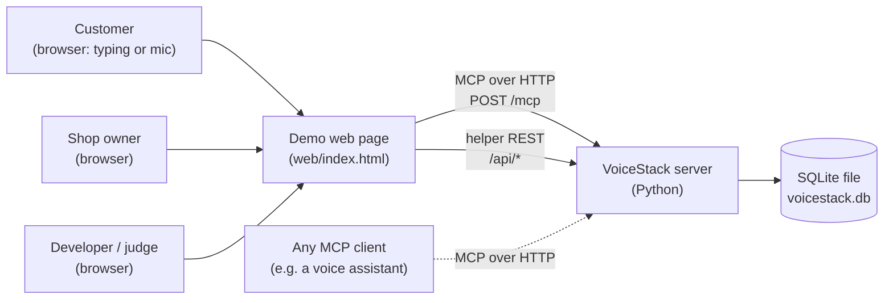

The dashed line is the intended production path (an assistant calling the server). It was **not** exercised against a real Alexa+ device. See §16.

---

## 3. Architecture

### 3.1 Components

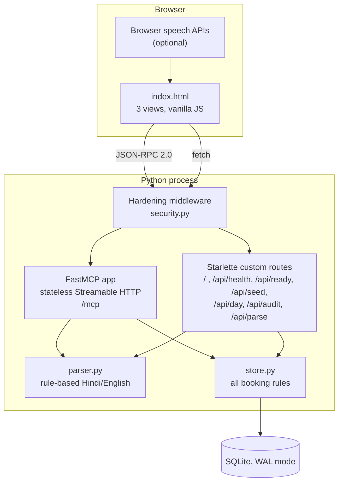

| Component | File | Responsibility |
|---|---|---|
| HTTP hardening | `voicestack/security.py` | One ASGI middleware in front of everything: request id and JSON logs, Host/Origin allow-list, rate limit, body-size cap, security headers (§12). |
| MCP tools | `voicestack/server.py` | Eight thin functions decorated with `@mcp.tool()`. They validate nothing themselves; they call the store. |
| Helper routes | `voicestack/server.py` | Serve the page and read-only/demo endpoints (§9.3). |
| Booking core | `voicestack/store.py` | **The only code that reads or writes the database.** Holds every rule: hours, holds, expiry, idempotency, waitlist, audit. |
| Parser | `voicestack/parser.py` | Turns plain text into structured fields. Pure functions, no network, no model. |
| Front end | `web/index.html` | One file: HTML, CSS and JavaScript for the three views. |
| Tests | `tests/test_core.py`, `scripts/mcp_smoke.py` | Unit/behaviour tests and an end-to-end MCP client check. |

### 3.2 Design principles
1. **One authority.** Only `store.py` touches the database. The server, the parser and the page cannot bypass its rules.
2. **No model writes.** Nothing that interprets language can change data. The parser only *proposes* values; the owner approves catalogs and the customer approves appointments.
3. **Two-step actions.** Publishing is draft then approve. Booking is hold then confirm. Each step is a separate call.
4. **Server decides, client displays.** Dates are resolved and validated on the server in India time. The page never decides whether a slot is free.
5. **Fail honestly.** Errors have stable codes and human-readable messages. The page shows "Outcome unknown" rather than pretending success.

### 3.3 Request lifecycle
1. The page (or any MCP client) sends a JSON-RPC 2.0 `POST /mcp` with `tools/call`.
2. The hardening middleware checks Host and Origin, the rate limit and the body size (§12.2). FastMCP (stateless, JSON responses) then dispatches to the tool function in `server.py`.
3. The tool calls a method on the single `Store` object.
4. `Store` takes a process-wide re-entrant lock, opens a `BEGIN IMMEDIATE` transaction for writes, applies the rules, commits, and returns a plain `dict`.
5. FastMCP returns that dict as the tool result (`structuredContent.result`, mirrored as JSON text in `content`).

---

## 4. Technology stack

| Layer | Choice | Version | Why |
|---|---|---|---|
| Language | Python | 3.13 tested; 3.11+ expected to work (not tested) | Fast to build; official MCP SDK |
| MCP SDK | `mcp` (FastMCP) | **pinned `==1.30.0`** | Supports protocol 2025-11-25. Version 2.x renamed `FastMCP` to `MCPServer` and negotiates a newer protocol, so `server.py` would not import |
| Transport | Streamable HTTP, `stateless_http=True`, `json_response=True` | MCP spec 2025-11-25 | Each request stands alone: no session to lose, and a plain browser `POST` works |
| Web server | Starlette on uvicorn | installed as dependencies of `mcp` | Serves `/mcp` and the helper routes in one process |
| Database | SQLite (`sqlite3`, standard library), WAL mode for file databases | whatever ships with Python | Zero setup; a primary-key constraint gives a hard double-booking guard |
| Time zone | `zoneinfo` (`Asia/Kolkata`) | standard library; `tzdata` added on Windows | One authoritative clock |
| Front end | Hand-written HTML, CSS, JavaScript | none | No build step, no packages, works offline |
| Speech | Browser Web Speech API (`SpeechRecognition`, `speechSynthesis`) | browser-dependent | Free; optional; typing always works |
| Tests | `pytest` | latest | Simple fixtures; threads for concurrency |

**Not used:** any cloud service, any hosted model, any API key, any front-end framework. AWS services (Bedrock, Lambda, DynamoDB, SageMaker) are **not** part of this project.

---

## 5. Repository layout

```
voicestack/
├── LICENSE                     MIT
├── README.md                   Quick start and limitations
├── requirements.txt            runtime: mcp==1.30.0, tzdata (Windows only)
├── requirements-dev.txt        runtime + pytest
├── Dockerfile  .dockerignore   container image (non-root, /data volume, health check)
├── .github/workflows/ci.yml    tests on Python 3.12 and 3.13, end-to-end check, image build
├── docs/
│   ├── TECHNICAL_DOCUMENTATION.md   this file
│   └── USER_GUIDE.md                how to use the three views
├── scripts/
│   └── mcp_smoke.py            end-to-end check against a running server (real MCP client)
├── tests/
│   ├── test_core.py            23 tests: booking rules, waitlist, audit, parser
│   └── test_security.py        10 tests: origin/host, rate limit, body cap, headers, logs
├── voicestack/
│   ├── __init__.py
│   ├── security.py             hardening middleware and settings        (~275 lines)
│   ├── store.py                booking core, SQLite schema, all rules   (~480 lines)
│   ├── parser.py               rule-based Hindi/English parsing         (~140 lines)
│   └── server.py               MCP tools + helper routes                (~200 lines)
└── web/
    └── index.html              the three-view demo page                 (~620 lines)
```

Note: `parser.py` also contains a `normalize()` function and a `DEVANAGARI` table that no code calls. They are an earlier, unused approach to Devanagari input and can be deleted without effect; the live path is `ALIASES` and `parse_request()` (§8).

---

## 6. Data model

### 6.1 Entity-relationship diagram

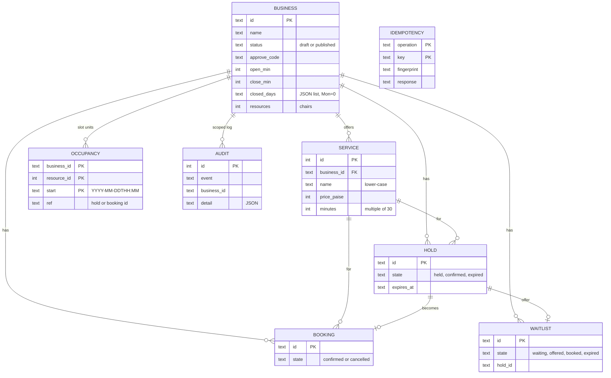

### 6.2 Table dictionary

| Table | Purpose | Key columns and rules |
|---|---|---|
| `business` | One row per shop | `status` is `draft` until the owner publishes. `approve_code` is returned once to the drafter. `open_min`/`close_min` are minutes after midnight. `closed_days` is a JSON list of weekday numbers (Monday = 0). `resources` is the number of chairs/stylists/rooms |
| `service` | What a shop sells | `price_paise` is an **integer** (₹300 = 30000) so there is no floating-point money. `minutes` must be a multiple of 30. Names are stored lower-case |
| `occupancy` | One row per 30-minute unit that is taken | **Primary key `(business_id, resource_id, start)`**. A hold or booking inserts one row per unit it covers. This is the hard double-booking guard (§7.3) |
| `hold` | A temporary reservation | `state`: `held`, `confirmed`, `expired`. `expires_at` is compared in code against the clock |
| `booking` | A confirmed appointment | `state`: `confirmed` or `cancelled` |
| `idempotency` | Remembered answers to retried confirms | Primary key `(operation, key)`; stores a hash of the request (`fingerprint`) and the original response |
| `waitlist` | Customers waiting for a taken slot | `state`: `waiting`, `offered`, `booked`, `expired`. `hold_id` is set when a slot is offered |
| `audit` | Append-only event log | `business_id` scopes it to one shop. Includes **refused** attempts (§13) |

### 6.3 State machines

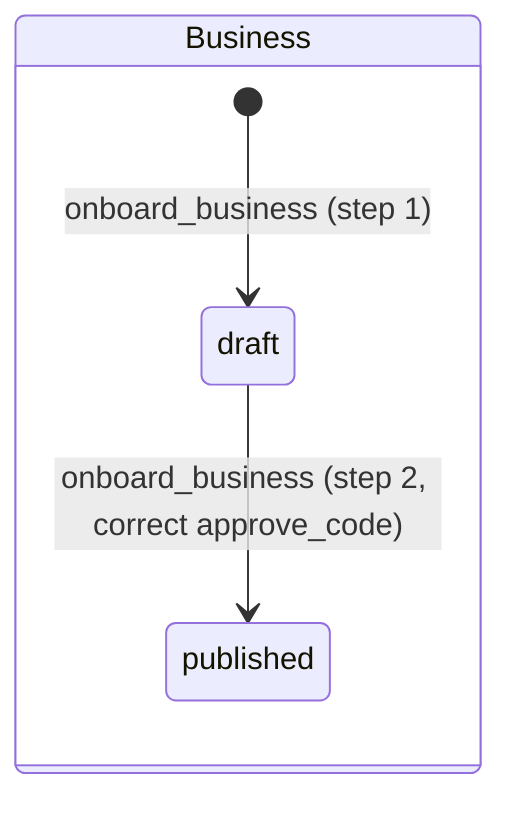

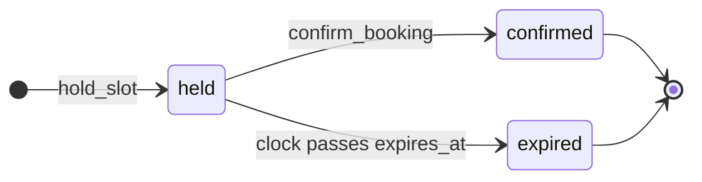

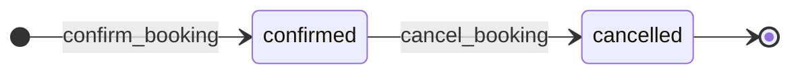

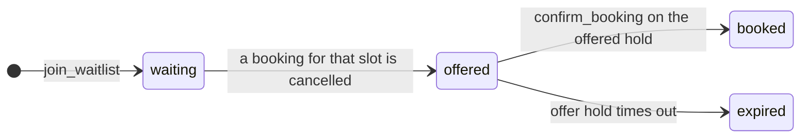

### 6.4 Invariants (always true)
1. At most one row exists in `occupancy` for any `(business, chair, 30-minute start)`.
2. A draft business never appears in `find_businesses` and cannot be held or booked.
3. A hold that is `held` has all of its `occupancy` rows; one that is `expired` has none.
4. A confirmed booking has `occupancy` rows pointing at its booking id; cancelling removes them.
5. The same `(operation, key)` can never map to two different responses.

---

## 7. Core mechanisms

### 7.1 Time model
- All times are **India Standard Time** (`Asia/Kolkata`). The server clock is `datetime.now(IST)` with the offset removed, and every stored time is a naive local string `YYYY-MM-DDTHH:MM`.
- The smallest bookable unit is **30 minutes** (`UNIT`). Services must be multiples of 30 minutes.
- Relative words such as "kal" (tomorrow) are resolved **on the server** from its clock, never by a model or the browser.
- The clock is injectable (`Store(path, clock=...)`), which is how tests simulate time passing without waiting.

### 7.2 Slot generation
There is no pre-generated calendar. When `get_slots` is called, the server walks the day from opening to closing in 30-minute steps. A start time is offered when the service still fits before closing, the day is not a closed day, the time is in the future, and **at least one chair is free for every unit** the service needs. Expired holds are released first.

### 7.3 Preventing double-booking (three layers)
1. **Process lock.** `Store` wraps each operation in a re-entrant `threading.RLock`, so operations from different request threads run one at a time.
2. **Database write lock.** Writes begin with `BEGIN IMMEDIATE`, which takes SQLite's write lock up front. This also protects against a second process opening the same file (with `busy_timeout=5000`).
3. **Primary-key constraint.** Even if layers 1 and 2 were somehow bypassed, inserting an `occupancy` row for an already-taken unit raises `IntegrityError`, which is caught and returned as `slot_taken`. The database itself refuses the second booking.

Chairs: with *N* chairs, the lowest-numbered free chair is assigned. A long service takes the same chair for all of its units. In testing, 20 simultaneous requests for one slot on a one-chair shop produced exactly 1 success; on a two-chair shop, exactly 2.

### 7.4 Holds and expiry
`hold_slot` reserves the slot for **120 seconds** (`HOLD_TTL_SECONDS`) and returns a `read_back` sentence ("haircut at Raj Salon on Sat 24 Oct at 17:00, ₹300, for Sanika. Confirm?"). Expiry is **not** a database feature. Each read and write first runs `_release_expired()`, which compares `expires_at` with the clock in code, deletes the hold's occupancy rows and marks it `expired`. This makes expiry testable with a fake clock.

### 7.5 Idempotent confirmation
`confirm_booking(hold_id, idempotency_key)`:
1. Computes a fingerprint (SHA-256 of the request).
2. If `(confirm, key)` already exists with the **same** fingerprint, returns the stored response with `"replayed": true`. No second booking is made.
3. If the key exists with a **different** fingerprint (same key, different hold), returns `idempotency_key_reused`.
4. Otherwise confirms, stores the response, and returns it, all in one transaction.

`cancel_booking` is naturally idempotent (cancelling twice reports `already_cancelled`). **`hold_slot` is not idempotent**: calling it twice makes two holds. This is a known gap (§17).

### 7.6 Waitlist
`join_waitlist` is allowed only when the slot is currently unavailable (otherwise `slot_free`). When `cancel_booking` frees a slot, the longest-waiting entry for that exact start time is **offered** a fresh 120-second hold inside the same transaction, so no third party can slip in between. The customer polls `check_waitlist`; when the state is `offered` it returns a `hold_id` and a read-back, and the normal `confirm_booking` completes it. If the offer expires, the slot simply becomes free again; it is **not** passed on to the next waiter.

### 7.7 Onboarding validation
`onboard_business` is a two-step call (§10.1). Step 1 validates that the name is present, at least one service exists, hours satisfy `0 <= open < close <= 24:00`, prices are positive, and durations are multiples of 30. The extraction also reports **assumptions** as warnings: a missing duration (assumed 30 minutes), missing hours (assumed 10:00-20:00), or no closed day found. The draft is never presented as complete when something was guessed.

---

## 8. Language handling

All language handling is **rule-based**. There is no model call anywhere in the project.

### 8.1 Owner text → catalog (`parse_onboarding`)
Input such as `haircut 300 30min, beard 150 60min, open 10-8, closed sunday`.
- Opening hours: a range like `10-8`, `10 to 8`, `9am-5pm`. If the closing time is not after the opening time, 12 hours are added (`10-8` → 10:00-20:00).
- Closed days: a weekday word within two words of `closed`, `band` or `off`.
- Services: `<name> [rs|rupees] <price> [<minutes> min]`, split on commas, newlines, `and`, `aur`. Durations are rounded to the nearest 30 minutes, with a minimum of 30.
- Returns flags `hours_assumed` and, per service, `minutes_assumed`, which the server turns into the warnings in the draft.

### 8.2 Customer text → request (`parse_request`)
Input such as `kal shaam 5 baje haircut` or `कल शाम 5:00 बजे हेयरकट`. Output: `{service, date, time, missing[]}`.

| Part | How it is found |
|---|---|
| Service | The service name appears in the text; or a Devanagari spelling from `ALIASES` (e.g. हेयरकट → haircut, दाढ़ी → beard); or a single distinctive word that matches exactly one service ("exam" → "exam prep") |
| Date | `aaj`/आज = today; `kal`/कल/`tomorrow` = tomorrow; `parso`/परसों = day after; a weekday name in Roman or Devanagari = next such day; an ISO date |
| Time | `5:00`, `5 pm`, `5 baje`/`5 बजे`. With a hint word (`shaam`/शाम/evening → pm, `subah`/सुबह → am). A bare hour 1-7 with no hint is read as afternoon (5 baje → 17:00) |
| Digits | Devanagari digits (०-९) are converted first |

Matching of Devanagari words uses substring checks, because regular-expression word boundaries are unreliable around Devanagari vowel signs.

### 8.3 Follow-up memory (in the page)
If a request is incomplete, the page keeps what it already learned and merges the next message. "कल दाढ़ी" followed by "सुबह 11 बजे" completes the request. When only the time is missing, the assistant fetches free slots and shows them as tappable buttons.

### 8.4 Known language limits
- "kal"/कल also means "yesterday" in Hindi; it is always read as **tomorrow**.
- Service names the owner writes in an arbitrary script are matched only by exact text, not by transliteration.
- Spoken Hindi quality depends on the browser's recogniser and was **not tested with real speech** during development; Devanagari parsing was tested with text.

---

## 9. API reference

### 9.1 MCP tools
Endpoint: `POST /mcp`, protocol `2025-11-25`, headers `Content-Type: application/json` and `Accept: application/json, text/event-stream`. Results are plain objects with `ok: true` or `ok: false`, an `error` code and a `message`.

| # | Tool | Arguments | Success result (key fields) |
|---|---|---|---|
| 1 | `onboard_business` | **Step 1:** `name`, `description`, optional `resources` (chairs, default 1). **Step 2:** `business_id`, `approve_code` | Step 1: `status:"draft"`, `business_id`, `approve_code`, `draft{name,hours,closed[],chairs,services[]}`, `warnings[]`, `next`. Step 2: `status:"published"` |
| 2 | `find_businesses` | `query` (optional words) | `businesses[]` with `business_id`, name, hours, closed days, chairs, services (published only) |
| 3 | `get_slots` | `business_id`, `service`, `date` (`YYYY-MM-DD`) | `slots[]` of free start times (`HH:MM`) |
| 4 | `hold_slot` | `business_id`, `service`, `date`, `time`, `customer_name` | `hold_id`, `expires_in_seconds` (120), `read_back` |
| 5 | `confirm_booking` | `hold_id`, `idempotency_key` | `booking_id`, `status:"confirmed"`, `start`, `customer`; `replayed:true` on a retry |
| 6 | `cancel_booking` | `booking_id` | `status:"cancelled"`, `already_cancelled`, `waitlist_offered` |
| 7 | `join_waitlist` | `business_id`, `service`, `date`, `time`, `customer_name` | `waitlist_id`, `state:"waiting"` (or `already_waiting`) |
| 8 | `check_waitlist` | `waitlist_id` | `state`; when `offered`: `hold_id`, `expires_in_seconds`, `read_back` |

**Authentication.** None. Every tool is public; the hardening layer (§12) limits abuse but does not identify callers.

**Example: a draft with assumptions** (real output, shortened)
```json
{ "ok": true, "status": "draft", "business_id": "biz_443da8a5", "approve_code": "64e3ec",
  "draft": { "name": "Smoke 13cf", "hours": "10:00-20:00", "closed": ["Sun"], "chairs": 1,
             "services": [{ "name": "haircut", "price": "₹300", "minutes": 30 }] },
  "next": "Owner must call onboard_business again with business_id and approve_code to publish.",
  "warnings": [] }
```

**Example: a conflict**
```json
{ "ok": false, "error": "slot_taken", "message": "That slot was just taken. Please choose another time." }
```

**Example: a retried confirm**
```json
{ "ok": true, "booking_id": "bk_NBG6gZQ1rrDm", "status": "confirmed", "start": "2026-10-26T17:00",
  "customer": "Smoke", "replayed": true }
```

**Raw request** (works from a plain `fetch`/`curl`, no session needed):
```bash
curl -s -X POST http://localhost:8000/mcp \
  -H 'content-type: application/json' \
  -H 'accept: application/json, text/event-stream' \
  -H 'MCP-Protocol-Version: 2025-11-25' \
  -d '{"jsonrpc":"2.0","id":1,"method":"tools/call","params":{"name":"find_businesses","arguments":{}}}'
```

### 9.2 Error codes

| Code | Meaning |
|---|---|
| `invalid` | Missing or malformed input (empty name, bad time format, bad prices/durations) |
| `invalid_date` | Date is not `YYYY-MM-DD` |
| `not_found` | Unknown or unpublished business, hold, booking or waitlist entry |
| `unknown_service` | No single service matches the given name |
| `unavailable` | Closed day, outside opening hours, not on a 30-minute boundary, or in the past |
| `slot_taken` | Every chair is occupied for at least one needed unit |
| `slot_free` | `join_waitlist` was called for a slot that is free; book it directly |
| `hold_expired` / `hold_confirmed` | The hold can no longer be confirmed (state shown after `hold_`) |
| `idempotency_key_reused` | The key was already used for a different request |
| `bad_code` | Wrong `approve_code`; the message says how many attempts are left |
| `locked` | Five wrong approval codes were entered for one draft; it can no longer be published. Create a new draft |

### 9.3 HTTP helper routes
These serve the demo page. They are **not** MCP tools.

| Method and path | Purpose | Notes |
|---|---|---|
| `GET /` | The demo page | |
| `GET /api/health` | `{ok, version:4, tools:8}` | Public. The page uses it to detect an out-of-date server |
| `GET /api/ready` | `{ok:true}` or 503 | Public readiness probe (database answers) |
| `POST /api/seed` | Creates and publishes three sample shops (skips existing names) | Demo only; **bypasses owner approval**. `VOICESTACK_ENABLE_SEED=0` returns 404 |
| `GET /api/day?business_id=&date=` | Bookings and holds for one day, totals inputs | Public. Includes customer names |
| `GET /api/audit?business_id=&limit=` | Shop-scoped event log, newest first | Public. Limit capped at 200; non-numeric limit → 400 |
| `POST /api/parse` | `{text, service_names[]}` → `{service,date,time,missing[]}` | Public. Text cut at 500 characters, 50 service names; bad JSON → 400 |
| `GET /favicon.ico` | Inline SVG icon | |

### 9.4 HTTP status codes added by the hardening layer

| Status | When |
|---|---|
| 403 | `Host` or `Origin` header not in the allow-list (`forbidden_host`, `forbidden_origin`) |
| 413 | Request body over 1 MiB |
| 429 | Rate limit exceeded; `Retry-After` says when to retry |

Every response carries `X-Request-ID` (echoes a safe client value, otherwise generated).

---

## 10. Key flows

### 10.1 Owner onboarding

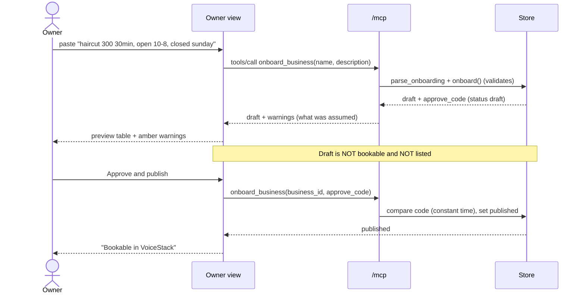

### 10.2 Customer booking (happy path)

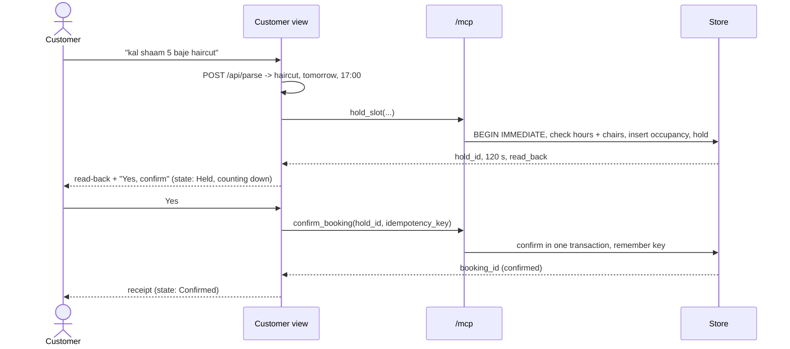

### 10.3 Conflict, waitlist and cancellation

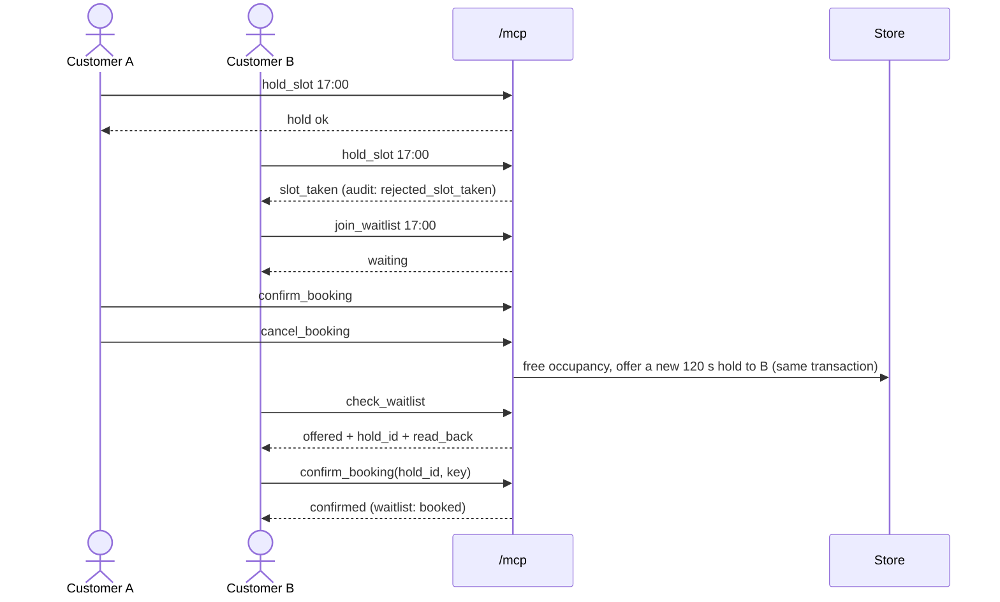

### 10.4 Unknown outcome
If the browser loses the network *during* `confirm_booking`, it shows **Outcome unknown**, then retries once with the **same** idempotency key. Because the key is remembered, the retry either returns the booking that already succeeded or makes it exactly once. If the second attempt also fails, the page tells the customer to check with the shop rather than claim success.

---

## 11. Front end

### 11.1 Structure
`web/index.html` is one self-contained file served at `/`. It has three `<main>` sections shown one at a time, chosen by tabs and by the URL hash (`#customer`, `#owner`, `#developer`). A shop selector in the header is shared by all views. A `<dialog>` holds the help content.

### 11.2 Customer view
- **State badge** with the exact states from the plan: Ready, Listening, Interpreting, Needs clarification, Loading slots, Held (with a live countdown), Confirming, Confirmed, Hold expired, Conflict, Outcome unknown. A success state is shown **only** after the server returns it.
- **Chat** with action buttons (confirm, no, free-time buttons, join waitlist).
- **Editable transcript:** the mic fills the text box; the user fixes it and presses Send.
- **Shop cards** (business results) and a **receipt** after confirmation, plus buttons to test a network retry, a rival customer, and cancellation.
- Optional spoken replies through `speechSynthesis`.

### 11.3 Shop owner view
Onboarding form with preview table and warnings; date picker; status filter (all, confirmed, held, cancelled); totals (confirmed, held, cancelled, waiting, scheduled value); booking table with a Cancel action; a day calendar with one column per chair; and the shop-scoped audit log. The view refreshes every 2 seconds while visible. "Scheduled value" sums **confirmed** bookings only and is labelled as not revenue.

### 11.4 Developer view
Request inspector (request number, time, tool, outcome, milliseconds; **arguments hidden**), a p50/p95/max latency table with the sample count shown, outcome counters (calls, ok, slot conflicts, expired holds, other errors), a statement that there are no background jobs, an optional raw wire log (off by default), the concurrency race test, and the server version and tool list.

### 11.5 Safety and accessibility notes
- All dynamic text is inserted with `textContent` or text nodes, never as HTML.
- Controls have labels or `aria-label`; the chat region uses `aria-live`; focus outlines are visible; light and dark colour schemes follow the system.
- The page is served with a Content-Security-Policy (§12.1); it uses inline script and style but loads nothing from other origins.
- A red banner appears if the server is unreachable or is an older version that lacks the new routes.

---

### 11.x Visual design system

The page follows the VoiceStack brand (logo and thumbnail). Colours and fonts are CSS variables at the top of `web/index.html`; a dark scheme is applied automatically from the browser setting.

| Token | Light | Use |
|---|---|---|
| `--cream` / `--paper` | #f3f0e8 / #fbf9f4 | page and card background (dot-grid pattern on the page) |
| `--forest` | #134a45 | headline, buttons, assistant frame |
| `--mint` | #b8e6cc | active tab, waveform, logo stroke |
| `--coral` / `--cta` | #e8795c / #bc523b | accent bar, centre waveform bar, "Yes, confirm" and "Approve & publish" |

Headlines use a serif system font stack (Georgia and similar); body text uses the system sans-serif. No web fonts are downloaded. The logo is an inline SVG and is also served as the favicon at `/favicon.ico`. The waveform animates only while the microphone is listening and stays still when the browser asks for reduced motion.

## 12. Security and privacy

### 12.1 Posture in one paragraph
VoiceStack is a **hardened demo**, not a production service. There is **no authentication**: every tool and route is public, including the owner views (`/api/day`, `/api/audit`), publishing and `/api/seed`. The HTTP layer limits abuse (Host and Origin checks, rate limit, body cap, security headers, structured logs) but does not know *who* is calling. There is no OAuth/account linking and no HTTPS of its own.

| Area | State | Remaining risk |
|---|---|---|
| Identity | None. Customer name is free text; any caller can use any tool or route | Anyone who can reach the port can create shops, book, read bookings |
| Approval code | 6 hex characters; **5 wrong tries lock the draft** (audited); constant-time compare | Without authentication the drafter is anonymous, so the approval step is a safety check, not a login |
| Customer capability IDs | `hold_id` / `booking_id` are random (about 72 bits) bearer tokens | Anyone holding an ID can use it |
| Cross-site / rebinding | Host and Origin allow-list on every request (defaults: localhost); MCP transport-level DNS-rebinding protection is also switched on explicitly | The allow-list must be set when you serve a real hostname |
| Abuse | Rolling per-client rate limit (default 600/min), 1 MiB body cap, input caps on `/api/parse` | In-memory, per process; behind a proxy set `VOICESTACK_TRUST_PROXY=1` so clients are told apart |
| Browser | CSP (`default-src 'self'`, no framing, no external loads), `nosniff`, `no-referrer`, microphone allowed for this origin only | CSP still allows inline script/style because the page is one file |
| Data exposure | Owner data routes are open; customer names are stored in plain text | **Do not run with real customer data** |
| Demo route | `/api/seed` publishes shops without owner approval | Demo only; `VOICESTACK_ENABLE_SEED=0` removes it |
| Injection | All SQL uses bound parameters; the page never renders HTML from data | No known path |
| Secrets | None exist: no API keys or tokens | Nothing to leak |

### 12.2 How a request is checked

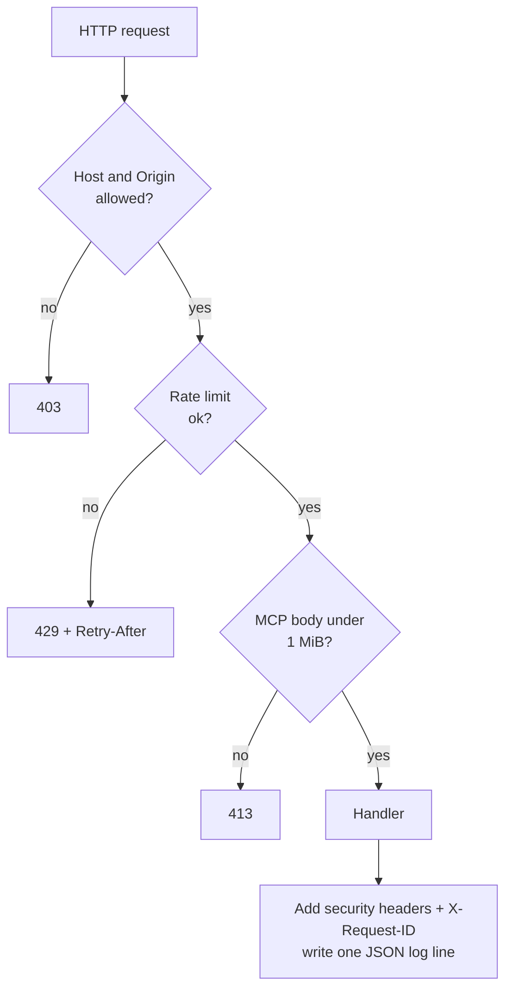

Details that matter:
- For `POST /mcp` the middleware reads the JSON-RPC body (including batches) to enforce the size cap and to put the tool names in the log, then replays the body unchanged to FastMCP.
- **Logs** are one JSON object per request: time, request id, client address, method, path, status, milliseconds and, for `/mcp`, the tool names. Request bodies and customer names are never logged (tested).

### 12.3 Production gaps (not built)
- **Authentication, including OAuth 2.1 with PKCE / account linking.** The Alexa+ MCP documentation reviewed during development says account linking is optional and, if used, requires OAuth 2.1 with PKCE (S256) and a refresh token. This project **does not implement it** and does not claim to. Verify the current requirements before building it. Intended design: identity from the verified token, **never** from model-supplied arguments such as `customer_id`; separate owner and customer scopes; owner tools and owner data restricted to the owner's own business.
- TLS termination (put it behind a reverse proxy or platform load balancer), a shared rate-limit store when running several processes, and a data-retention and consent policy for customer names and appointment times.

### 12.4 Configuration

| Variable | Default | Meaning |
|---|---|---|
| `VOICESTACK_ALLOWED_HOSTS` | `127.0.0.1:*,localhost:*,[::1]:*` | Comma list of allowed `Host` values (`:*` = any port) |
| `VOICESTACK_ALLOWED_ORIGINS` | `http://127.0.0.1:*,http://localhost:*,http://[::1]:*` | Comma list of allowed `Origin` values. Requests without an Origin (curl, MCP SDK clients) are allowed |
| `VOICESTACK_RATE_PER_MIN` | `600` | Requests per client per rolling minute; `0` turns the limiter off |
| `VOICESTACK_TRUST_PROXY` | `0` | `1` = take the client address from `X-Forwarded-For` (only behind your own proxy) |
| `VOICESTACK_ENABLE_SEED` | `1` | `0` removes the demo `/api/seed` route |

### 12.5 Privacy
Customer names and appointment times are stored in plain text in `voicestack.db`. The browser's speech recogniser may send audio to the browser vendor; the page says so next to the mic. No analytics or third-party scripts are loaded.

---

## 13. Reliability and observability

- **Audit log.** Every state change writes an event with a timestamp and the shop id: `draft_created`, `published`, `held`, `confirmed`, `cancelled`, `hold_expired`, `waitlist_joined`, `waitlist_offer`, and **refused attempts** `rejected_slot_taken`, `rejected_unavailable`, `rejected_confirm_expired`, `rejected_confirm_confirmed`. Rejections are written *after* the transaction ends so they are not rolled back with it. The audit log holds ids, times and service names, **not** customer names.
- **Structured access log.** One JSON line per request on stderr (fields in §12.2), with a request id that is also returned in `X-Request-ID`, so a report can be matched to a line. Pipe it to a file or a log service.
- **Probes.** `/api/health` (process is up, version) and `/api/ready` (database answers); the Docker `HEALTHCHECK` uses `/api/ready`.
- **Request inspector** (Developer view) records every MCP call the page makes.
- **Latency honesty.** Latency shown is the browser's round trip to `localhost`. It is **not** an Alexa+ end-to-end figure and includes no speech recognition. In the build environment single calls took roughly 10-30 ms and 20 simultaneous hold requests finished in about 70-200 ms. These are observations on one machine, not benchmarks, and the Developer view shows live numbers with sample counts so p95 is not over-read.
- **Backend vs. conversation time.** The access log records server-side milliseconds per request, so backend time is now measurable separately from the browser round trip. There are still no metrics dashboards or tracing.

---

## 14. Testing

### 14.1 Automated tests (`pytest -q`, 33 tests)

| Area | Tests |
|---|---|
| Onboarding | Draft not bookable until approved and wrong code rejected; owner-text parser; assumption flags |
| Slots and hours | Respect opening hours, closed days and service length; past and out-of-hours holds rejected |
| Holds and bookings | Hold then confirm removes the slot; second customer gets `slot_taken`; overlapping longer service blocked; two chairs allow two but not three |
| Idempotency | Same key returns the same booking and creates one row; reused key rejected |
| Time | Hold expiry frees the slot (fake clock); expired confirm refused |
| Cancellation | Frees the slot and is repeatable |
| Concurrency | 20 threads on one slot → exactly 1 winner; 20 threads on a two-chair shop → exactly 2 |
| Waitlist | Offer on cancel, stranger blocked while offered, first in line wins, offer expiry frees the slot |
| Owner data | Day view shows bookings and holds; audit is shop-scoped and records rejections and expiries |
| Language | Roman and Devanagari request parsing, including the case from real Hindi speech output |
| Approval code | Five wrong codes lock a draft, even the right code is then refused, both events are audited |
| HTTP hardening (`test_security.py`) | Security headers and request id; foreign Origin and foreign Host → 403; rate limit → 429 with `Retry-After`; 1 MiB cap → 413; input limits on `/api/parse`; seed switch and readiness probe; logs are JSON, name tools (also inside a batch) and contain no request data; public tools and routes work without credentials; default settings |

### 14.2 End-to-end check
`scripts/mcp_smoke.py` starts a real MCP client (initialize, `tools/list`, `tools/call`) against a running server and checks protocol negotiation, 8 tools advertised, draft not bookable, publish, hold, rival rejected, retry returns the same booking, and cancel frees the slot. It exits non-zero on failure. CI runs it against a freshly started server.

### 14.3 Browser verification
During development the three views were driven in a headless Chromium (Playwright) through the full flow: sample shops, onboarding with warnings, hold/confirm/receipt, retry, rival, cancel, waitlist offer, owner table and audit, and a 20-customer race. The page was also loaded with the Content-Security-Policy enforced, with no violations. These scripts are **not** included in the repository, so there are no automated UI tests; the UI should be re-checked by hand after changes.

### 14.4 Not tested
Real Alexa+ devices; real spoken Hindi; multiple server processes; very large data volumes; browsers other than Chromium; building and running the **Dockerfile** (no container runtime was available where it was written, so the image build is untested; the settings it relies on and its health-check command were checked directly); the GitHub Actions workflow (written but not yet run on GitHub). The unit tests were run on Python 3.11, 3.12 and 3.13.

---

## 15. Setup, configuration and operation

### 15.1 Install and run
```bash
# conda (or any virtual environment)
conda create -n voicestack python=3.13 -y
conda activate voicestack
cd voicestack
pip install -r requirements-dev.txt     # runtime + pytest (use requirements.txt for runtime only)
python -m voicestack.server        # MCP: http://localhost:8000/mcp   page: http://localhost:8000/
```
Open the page as `http://localhost:8000/` or `http://127.0.0.1:8000/`; other host names are refused until you add them to `VOICESTACK_ALLOWED_HOSTS` and `VOICESTACK_ALLOWED_ORIGINS`.

Run commands **from the project folder**: `python -m voicestack.server` imports the package by name.

**Container (untested here, see §14.4):**
```bash
docker build -t voicestack .
docker run --rm -p 8000:8000 -v voicestack-data:/data voicestack
```
The image runs as an unprivileged user, stores the database in the `/data` volume and listens on `0.0.0.0` inside the container. Publish the port only on a trusted interface (`-p 127.0.0.1:8000:8000`) unless you put HTTPS and the allow-lists in front of it.

### 15.2 Configuration (environment variables)

| Variable | Default | Meaning |
|---|---|---|
| `VOICESTACK_DB` | `voicestack.db` | Path of the SQLite file (`:memory:` also works for experiments) |
| `HOST` | `127.0.0.1` | Interface to listen on (the Dockerfile sets `0.0.0.0`) |
| `PORT` | `8000` | Port |

Security-related variables (`VOICESTACK_ALLOWED_HOSTS`, `VOICESTACK_ALLOWED_ORIGINS`, `VOICESTACK_RATE_PER_MIN`, `VOICESTACK_TRUST_PROXY`, `VOICESTACK_ENABLE_SEED`) are listed in §12.4.

Example (Windows PowerShell): `$env:PORT=8010; python -m voicestack.server`.

### 15.3 Operations
- **Reset to a clean demo:** stop the server (Ctrl+C), delete `voicestack.db` (and `voicestack.db-wal`, `voicestack.db-shm` if present), start again, then load the sample shops.
- **Backup:** copy the database file while the server is stopped.
- **Upgrade from an older database:** the audit table gains a `business_id` column automatically on start.
- **Run the tests:** `pytest -q`. **Run the smoke check** (server running): `python scripts/mcp_smoke.py`.
- **Logs:** JSON lines on stderr; redirect with `python -m voicestack.server 2> access.log`.

### 15.4 Troubleshooting

| Symptom | Cause and fix |
|---|---|
| Red banner "You are probably running an OLD copy of the server" | An old server process is still running. Press Ctrl+C in its terminal, open the *new* folder, start again, hard-refresh (Ctrl+Shift+R) |
| "Load 3 sample shops" seems to do nothing | The shops already exist, so nothing new is created. Check the shop selector |
| `ModuleNotFoundError: mcp.server.fastmcp` | `mcp` 2.x got installed. Run `pip install "mcp==1.30.0"` |
| "Address already in use" | Another process holds port 8000. Stop it, or set `PORT` |
| HTTP 403 `forbidden_host` / `forbidden_origin` | You opened the page through a host name that is not allow-listed; use `localhost` or add it to the allow-lists |
| HTTP 429 | Too many requests from this client; wait the `Retry-After` seconds |
| `ZoneInfoNotFoundError` on Windows | Install the time-zone data: `pip install tzdata` (included in `requirements.txt`) |
| Mic button missing | The browser has no speech recognition. Use Chrome, or type |
| Hindi speech is misheard | Edit the text in the box before sending; accuracy depends on the browser |
| Everything fails after a code change | Stop and restart the server; it does not hot-reload |

---

## 16. Alexa+ integration notes

This section records what was learned from the public hackathon material and the Alexa+ documentation reviewed while building. **Verify against current documentation before relying on it.**

- The hackathon's Alexa+ track accepts a **self-hosted MCP server** (Streamable HTTP), an agent skill, or a **simulated Alexa+ web application**. Alexa+ add-on tooling is not available to participants, so this project's page *simulates* the assistant: it is a genuine MCP client (initialize, `tools/list`, `tools/call`) with typed or browser-recognised speech standing in for the device.
- Documented constraints (as reviewed): tool round trips should complete in under about 500 ms; tool metadata refreshes only when an add-on is deployed; account linking, if used, needs OAuth 2.1 with PKCE.
- Design implication already followed: the tools are **generic** (`find_businesses`, `get_slots`, `hold_slot`, ...). Adding a third shop needs data, not a new tool or a redeploy.
- There is no authentication; a deployment for real Alexa+ use would need OAuth account linking (§12.3).
- **Not done:** account linking, deployment behind public HTTPS, and any test on a real device or Alexa+ preview.

---

## 17. Known limitations and future work

### 17.1 Limitations
1. No authentication or authorisation: every tool and route is public (§12).
2. `hold_slot` is not idempotent; a retried hold request creates a second hold.
3. Waitlist offers are not passed to the next person if the first lets the offer expire.
4. Single time zone, fixed 30-minute grid, no payments, no reminders, no calendar sync.
5. Rule-based language handling covers common phrases only; "kal" is always tomorrow; custom services in other scripts are matched only by exact text.
6. The 14-day pre-generated availability from the original plan was **not built**; slots are computed on demand, which is simpler and correct for this scale but untested at large scale.
7. Owner "editing" of a draft is done by editing the message and extracting again; there is no per-field editor.
8. Single process. Several server processes on one database file would stay correct (write lock and primary key) but share no in-memory state and were not tested.
9. Server-side latency is in the access log, but the inspector still shows browser round trips and there are no metrics dashboards.
10. No automated browser tests in the repository.
11. Tested: Python 3.11-3.13 (unit tests), Chromium (UI). The Dockerfile and CI workflow have not been run (§14.4).
12. Rate limits are in memory and per process.

### 17.2 Future work
OAuth 2.1 + PKCE with owner and customer scopes; idempotent holds; passing waitlist offers down the queue; per-field draft editor; metrics and tracing on top of the access log; owner notifications; payments and reminders; a language-model *extractor* that may only propose drafts (never write), behind the same approval step; a reusable package of the reliability helpers (idempotency, approval envelope, timing).

---

## 18. Glossary

| Term | Meaning |
|---|---|
| **MCP** | Model Context Protocol. A standard for an AI client to discover and call functions ("tools") on a server |
| **Tool** | One named function the server exposes over MCP |
| **Streamable HTTP** | The MCP transport that carries JSON-RPC messages over ordinary HTTP `POST` requests |
| **Stateless** | The server keeps no per-client session; every request is self-contained |
| **Hold** | A short, temporary reservation that is released automatically if not confirmed |
| **Idempotency key** | A caller-chosen unique string that makes a repeated request safe: the second call returns the first result |
| **Idempotent** | An operation whose repetition has no additional effect |
| **Occupancy** | One row per 30-minute unit of one chair that is currently taken |
| **WAL** | SQLite's write-ahead-log mode, which allows reading while writing |
| **Paise** | One hundredth of a rupee; prices are stored as whole paise |
| **PKCE** | A sign-in safeguard that ties an authorisation code to the client that asked for it |
| **Waitlist offer** | A hold created automatically for the next waiting customer when a booking is cancelled |
| **Audit log** | An append-only record of changes and refused attempts |
